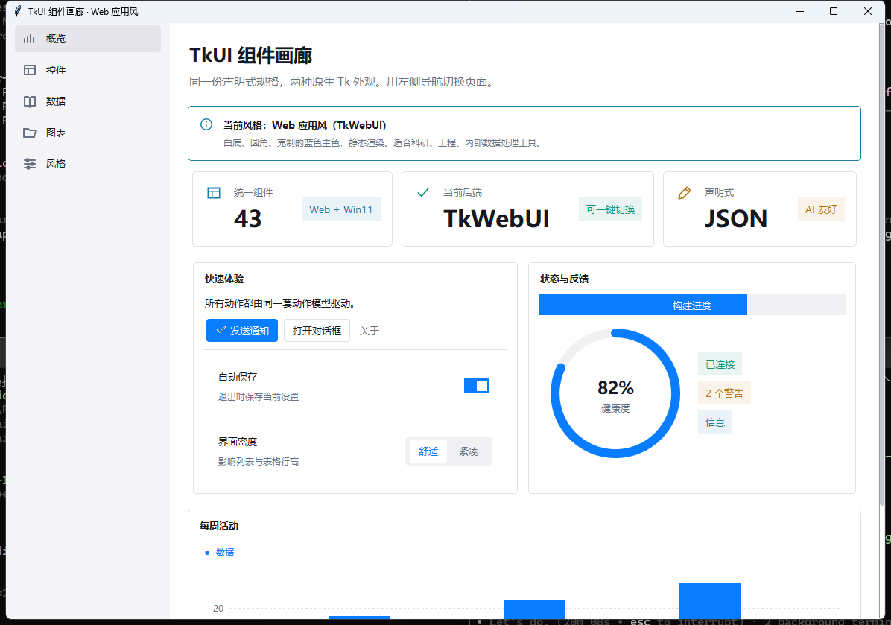
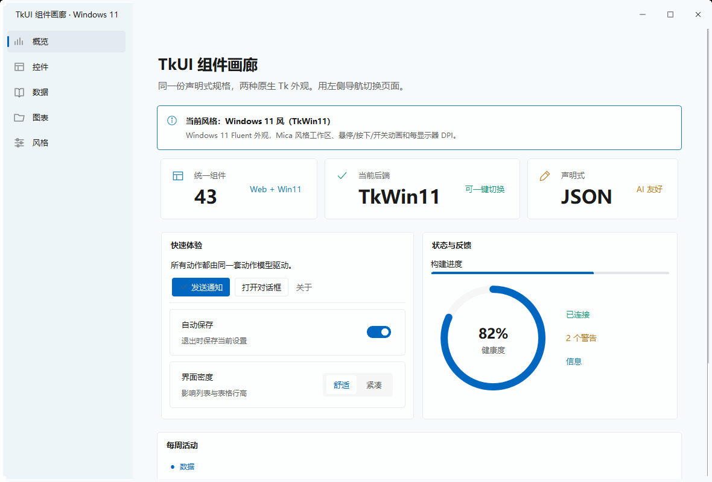

# 两个组件库分别代表什么效果

这份文档是 TkUI 设计前的调研结论：TkWebUI 和 TkWin11 分别解决什么问题、外观与
交互差在哪里、为什么可以把它们收进同一套 AI 友好的声明层。

## 一句话结论

- **TkWebUI = 现代 Web 应用风**：白底、圆角、`#087DFF` 蓝、静态渲染、信息密度高，
  适合科研、工程和内部数据工具。
- **TkWin11 = Windows 11 Fluent 风**：Mica 感工作区、`#0067C0`、原生控件质感、
  悬停/按下/开关/导航/页面切换动画、每显示器 DPI、一体化标题栏，适合面向 Windows
  用户的桌面软件。

TkWin11 由 TkWebUI 分支而来，公开组件名几乎一一对应，但实现路线不同。TkUI 利用
这一点建立**风格无关组件词汇表**，把“选哪个库”变成运行时的外观选择。

## 效果对照

| 维度 | TkWebUI（web） | TkWin11（win11） |
| --- | --- | --- |
| 整体气质 | Web / SaaS 控制台 | Windows 11 系统应用 |
| 画布底色 | `#FFFFFF` | `#FDFEFE`，页面工作区 `#F7FAFC` |
| 侧栏 | `#F5F5F7`，浅灰导航 | `#EEF5F9`，带蓝色选中指示 |
| 主色 | `#087DFF` | `#0067C0` |
| 边框 | `#E1E2E8` | `#E8EBED` |
| 圆角 | 约 5–6 px 的卡片/输入框 | Fluent 控件（开关、滑块、卡片）自带形态 |
| 动效 | 无过渡 | 悬停、按下、开关、导航、页面切换都有动画 |
| 标题栏 | 系统标题栏 | 可选 Win11 一体化标题栏（`FluentTitleBar`） |
| 字体/DPI | 启动时按当前 DPI 生成 | 运行时按每块显示器缩放，窗口跨屏自动重排 |
| 经典 tk 控件 | 不接管，建议改用 ttk | `install()` 可连 `tk.Button` / `tk.Menu` 一起换肤 |
| 典型启动成本 | 约 +0.2 s | 约 +0.15 s，首次打开每页约 +70 ms |
| 库代码量 | 约 4.8k 行 | 约 9.1k 行 |

### Web 风的视觉证据


### Win11 风的视觉证据


### 同一份 TkUI 规格的两种结果

| Web | Windows 11 |
| --- | --- |
|  |  |

两张截图来自同一个 `tkui/demo.py`，页面结构、组件与属性完全一致，只有 `style`
不同。

## 实现路线

### TkWebUI：样式一次生成，之后不碰 Tk

```python
enable_dpi_awareness()
root = tk.Tk()
apply_theme(root)       # 创建 ttk 样式、图标、圆角图片
```

- `apply_theme` 用 ttk 样式和内存生成的 `PhotoImage` 画出圆角、图标、开关；
- 不修改 `tk.Tk` 的内部命令，不做运行时动画；
- 行为可预期，源码短，适合需要“界面只是工具”的场景；
- 经典 `tk.Button` 不会被自动替换，旧程序需要改用 ttk 或上游组件。

### TkWin11：运行时接管，换取 Fluent 体验

```python
import tkwin11
tkwin11.install()       # 可选：在 Tk() 之前接管经典控件
root = tk.Tk()
apply_theme(root)
configure_fluent(root)
```

- 在运行时接管 ttk 样式、字体、图片和控件命令；
- 每个控件有动画控制器，支持可中断过渡；
- 通过 DPI 资源表按显示器缩放，窗口跨屏时重新适配；
- `FluentTitleBar` / `FluentWindowChrome` 提供一体化标题栏与原生拖拽；
- `install()` 会把经典 `tk.*` 控件也纳入主题，因此旧程序可以“一行换肤”；
- 代价是代码量约为 Web 风的 1.9 倍，启动和切页有额外开销。

## API 重合度

两者同源，以下名字和签名基本一致：

```text
apply_theme / enable_dpi_awareness / icon
Card / SectionCard / Sidebar / ScrollArea / Tooltip / Dropdown / Accordion
SegmentedControl / SettingRow / CardList / ProgressSlider / Modal
ThemedCombobox / ThemedMenu / ChoicePopup
SquareSwitch / ToggleButton / ToolButton / MenuButton / OptionMenu / RoundedListbox
SortableTreeview / Spreadsheet / DataTable
LineChart / ColumnChart / ScatterChart / DonutChart / PieChart
Badge / ValidatedEntry / Dialogs / DateEntry / CalendarPopup / ValueSlider
ToastNotification / notify / TextProgress / Meter
ColorPicker / FontPicker / ImageViewer / WindowChrome
```

TkWin11 额外提供：

```text
install / uninstall / theme_classic
configure_fluent / FluentPage / NavigationView
SettingsCard / ExpanderCard / FluentSwitch / FluentSlider / FluentButton
FluentTitleBar / FluentWindowChrome / KeyChord / FormFlyout
```

少数签名差异（例如 `Card(command=...)`、`SettingRow(command=...)`、
`ScrollArea(reserve_scrollbar=...)`）由 TkUI 的渲染器吸收，规格层不暴露。

## 为什么不能直接混用

两个库都会创建同名 ttk 样式、同名 Tcl 命令、共享 `PALETTE`，并且 TkWin11 会接管
控件命令。上游 README 明确写了：**同一个 Tk 解释器里不要混用**。因此 TkUI 的策略是：

1. 进程内只 import 一个后端；
2. 风格在创建根窗口前决定；
3. 运行中切换时保存偏好，`subprocess` 启动新进程，旧进程退出；
4. `choose_style()` 使用纯标准 Tk 绘制选择器，此时两个主题库都还没导入。

这比“两个库都 import、运行时替换控件”可靠得多。

## 什么时候选哪个

| 需求 | 建议 |
| --- | --- |
| 内部数据工具、科研脚本、需要稳定行为 | `web` |
| 表格、图表、表单很多，界面只是工具 | `web` |
| 要发给 Windows 11 用户，追求系统原生感 | `win11` |
| 需要一体化标题栏、每屏 DPI、过渡动画 | `win11` |
| 需要连旧程序的 `tk.Button` / `tk.Menu` 一起换肤 | `win11` |
| 机器性能有限、启动时间敏感 | `web` |
| 希望用户自己决定 | 用 TkUI 的 `--choose` / `choose_style()` |

## TkUI 的取舍

### 1. 统一词汇表，而不是统一实现

规格里只出现 `button`、`switch`、`settings_card` 这样的语义名，不出现
`ttk.Button(style='Primary.TButton')`。渲染器负责把语义映射到两套后端。

### 2. Win11 独有组件要有等价物

- `expander` → Web 用 `accordion`；
- `settings_card` → Web 用 `Card + SettingRow`；
- `keychord` → Web 用只读输入框；
- 自定义标题栏 → Web 用系统标题栏。

这样 AI 不需要为两种风格写两份页面。

### 3. 目录即契约

`tkui/catalog.py` 是唯一事实来源：组件名、属性、枚举、事件、示例、默认布局。
JSON Schema、AI 提示词、Markdown 目录和测试都从它生成或校验，避免文档漂移。

### 4. 校验要能指导修复

错误信息带 JSON 路径与相似名称建议，例如：

```text
$.body.children[0].type: 错误: 未知组件 'buton'，是否想写 'button'？
$.body.children[2].id: 错误: id 'name' 已在 $.body.children[0].id 使用
```

`python -m tkui check app.json --json` 还返回规格中引用的 Python 动作名，方便接线。

### 5. 动作模型要同时服务 AI 与人类

- 纯 JSON：`{"action": "notify", "message": "已保存"}`
- Python：`"command": "save"` + `actions={"save": fn}`
- 事件：`on.change`、`on.select`、`on.activate`

这样 AI 可以先交付可运行的界面，再逐步接入业务逻辑。

## 已知限制

- Tk 没有真正的 Mica/Acrylic；Win11 风是 Fluent 近似，不是 WinUI 3。
- 两个后端的清理回调在 Python 3.15/Tk 9 下关闭时可能产生
  `can't delete Tcl command`，TkUI 的 `App.close()` 会过滤这类无害信息。
- 图表与小工具定位相符，不处理百万级数据。
- `ImageViewer` 的非 PNG/GIF/PPM 格式需要 Pillow；其余组件只需标准库。
- 主题切换必须重启进程，这是上游限制，不是 TkUI 的实现缺陷。

## 参考

- TkWebUI README / docs：<https://github.com/bvb6417/tkwebui>
- TkWin11 README / CHANGELOG：<https://github.com/bvb6417/tkwin11>
- TkUI 规格：`references/spec.md`
- TkUI 的 AI 用法：`references/declarative.md`
